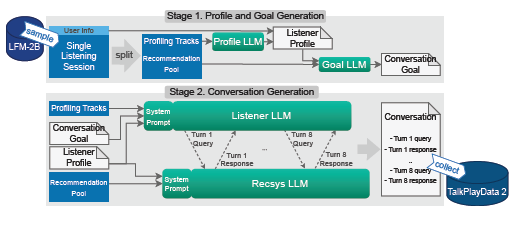
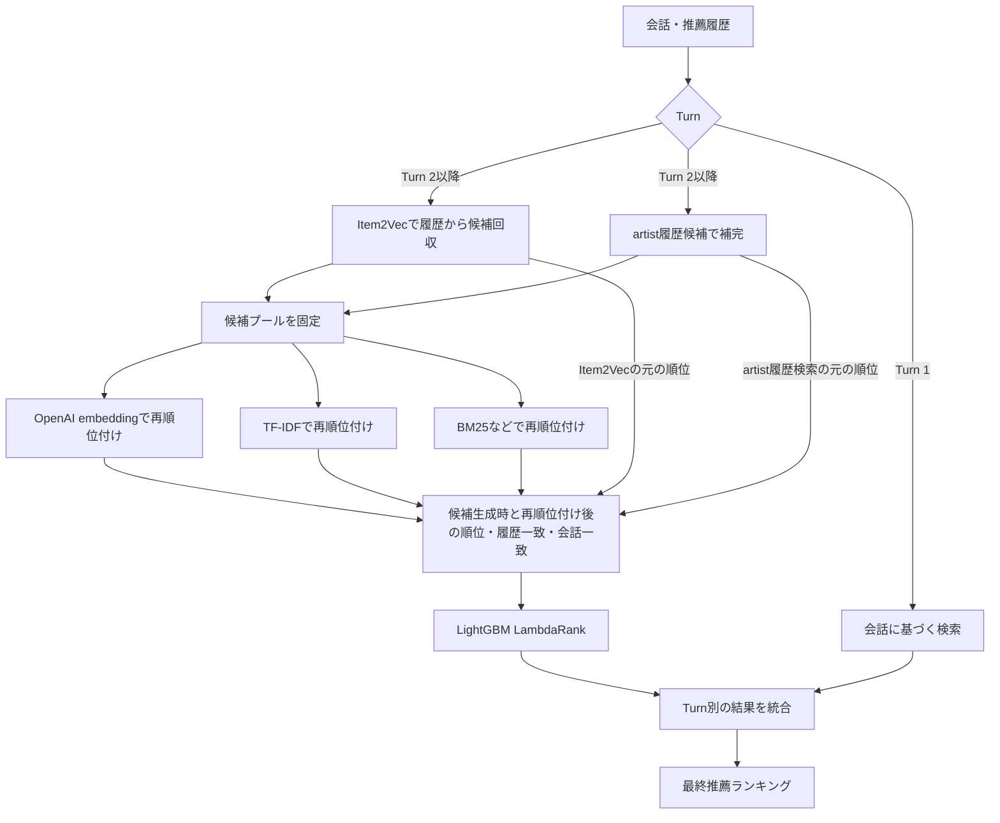

# RecSys Challenge 2026

会話型音楽推薦のランキング部分を担当し、**データセットの生成構造を踏まえた
候補プール設計と、会話に合う楽曲を選ぶ学習型リランキング**に取り組みました。

## コンペティション概要

RecSys Challenge 2026: Music-CRSは、対話を通じてユーザーの音楽嗜好を理解し、
楽曲を推薦する**会話型音楽推薦**のコンペティションでした。システムには、過去の
会話とユーザープロファイルをもとにカタログから関連楽曲Top-20を順位付きで提示し、
その推薦理由を含む自然で一貫した応答を生成することが求められます。

1つの会話セッションは最大8ターン続きます。ここで1ターンとは、ユーザーの発話に
対してシステムが楽曲ランキングと応答を返す、1回のやり取りです。最初のTurn 1では
過去の推薦曲がまだありませんが、Turn 2以降（2〜8ターン目）では、それまでに
推薦した楽曲と会話の流れを次の推薦に利用できます。

評価は、推薦ランキングと生成応答の両面から行われます。公式の総合スコアは、
次の4指標の加重和です（[公式評価方法](https://www.recsyschallenge.com/2026/)）。

| 評価対象 | 指標 | 重み | 評価内容 |
|---|---|---:|---|
| 推薦ランキング | nDCG@20 | 0.50 | 正解楽曲を上位に推薦できているか |
| 推薦ランキング | Catalog Diversity | 0.10 | カタログ全体から幅広く推薦できているか |
| 生成応答 | Lexical Diversity | 0.10 | 推薦応答の表現に多様性があるか |
| 生成応答 | LLM-as-a-Judge | 0.30 | 応答のパーソナライズと推薦理由の品質 |

## 参加体制と私の担当

研究室メンバー計10名のチーム`uec_okmt_lab`として参加しました。
私は主にTurn 2以降の推薦ランキングを担当し、Item2Vecによる候補生成、
固定候補に対する検索手法別の順位付け、特徴量設計、LightGBMによるリランキング、
turn別の評価・分析を実装しました。

このリポジトリは、私の担当部分を合成データで実行できるポートフォリオとして
再構成したものです。以下の実験精度はコンペティションの開発セット（Dev）での
評価結果であり、公開用デモの結果とは区別しています。

## 課題の分析とアプローチ

### 1. 複数のretrieval手法を比較する

最初に、会話や推薦履歴から正解楽曲の候補を見つけるretrieval手法を比較しました。
各手法の狙いは次のとおりです。

- **TF-IDF context**: ユーザーの発話に含まれるartist、曲名、album、tagなどの
  キーワードを重視し、文字として明示された要望に合う楽曲を検索します。
- **OpenAI embedding**: 累積した会話と楽曲情報をベクトルへ変換し、キーワードの
  完全一致だけでは捉えにくい雰囲気や嗜好の意味的な近さから楽曲を検索します。
- **BM25 dialogue**: listener goal、user profile、会話文をqueryとして、重要な
  キーワードが楽曲metadataへどの程度含まれるかを評価します。
- **BM25 item history**: それまでに推薦した楽曲のmetadataをqueryとして、過去の
  推薦履歴と関連する楽曲を検索します。このため、主にTurn 2以降で機能します。
- **Relation-aware Item2Vec**: 複数ユーザーのアイテム系列から楽曲同士の共起関係を
  学習し、さらにartist、album、tag、年代などのmetadata関係を同じ埋め込み空間へ
  統合します。推論時は、その時点までに推薦した楽曲embeddingを平均poolingして
  ユーザーの現在の嗜好を表し、そのベクトルに近い未推薦楽曲を上位候補とします。

Devにおける、リランキング前の単体評価は次のとおりです。
TF-IDF・OpenAI embedding・BM25は全8 Turnの8,000 query、Item2Vecは履歴を利用できる
Turn 2〜8の7,000 queryを対象としています。
評価には、正解楽曲を候補に含められたかを見るHit@Kと、正解をどれだけ上位に
置けたかを見るnDCG@Kを使います。Kは評価するランキングの上位件数です。

- **Hit@K**：正解楽曲が上位K件に含まれたqueryの割合です。例えばHit@20が0.30なら、
  30%のqueryで正解を上位20件以内に回収できたことを表します。
- **nDCG@K**：正解が上位にあるほど高く評価する指標です。今回のように各queryの
  正解が1曲の場合、1位なら1、順位が下がるほど小さくなり、上位K件に含まれなければ
  0になります。Hit@Kが同じでも、正解をより上位に並べた手法ほどnDCG@Kが高くなります。

| Retriever | Hit@20 | Hit@100 | Hit@500 | nDCG@20 | nDCG@100 | nDCG@500 |
|---|---:|---:|---:|---:|---:|---:|
| TF-IDF context | 0.2968 | 0.4763 | 0.6143 | 0.1077 | 0.1409 | 0.1587 |
| OpenAI cumulative all roles | 0.2515 | 0.4614 | 0.6561 | 0.1014 | 0.1400 | 0.1650 |
| BM25 item history all | 0.2318 | 0.3910 | 0.5239 | 0.0793 | 0.1087 | 0.1259 |
| BM25 dialogue all | 0.1883 | 0.3166 | 0.4196 | 0.0754 | 0.0993 | 0.1125 |
| Relation-aware Item2Vec（Turn 2〜8） | 0.3054 | 0.5050 | 0.6977 | 0.1457 | 0.1823 | 0.2071 |

Item2VecはUser発話を学習時の補助関係として加えたモデルです。

会話や楽曲metadataに基づく検索では、TF-IDFは上位20〜100件の回収、OpenAI
embeddingは上位500件までの広い回収に強みがありました。Item2Vecは推薦履歴を
使うTurn 2以降で、楽曲同士の関連性を利用した候補回収に有効でした。

一方、各手法が上位候補として回収する楽曲や、正解を回収できるqueryは異なりました。
語句の一致、意味的な近さ、楽曲の共起関係のいずれか一つでは、正解を十分に回収し、
上位へ並べることが難しく、**個別のretrieverだけで精度を向上させることには
限界がありました。**

そこで、検索手法を単純に置き換えるだけでなく、データセットの生成構造から
「何を候補として集め、何を基準に並べるべきか」を考え直しました。

### 2. データセットの生成構造に着目する



図1：TalkPlayData 2のデータ生成パイプライン。出典：Choi, Doh and Nam,
*TalkPlayData 2: An Agentic Synthetic Data Pipeline for Multimodal Conversational
Music Recommendation*, Figure 1（2025）［1］。

今回のTalkPlayData-Challengeは、**実際の音楽聴取データを土台として、LLMで
対話を生成した合成データセット**です［2］。基盤となるTalkPlayData 2では、
LFM-2Bの聴取セッションからプロフィール作成用の楽曲群と推薦用の楽曲プールを
分け、プロフィールと会話目標を作成します。その後、Listener LLMとRecsys LLMが
対話し、Recsys LLMは推薦用プールから楽曲を選びます［1］。

この生成構造から、**次の推薦曲を探すには、現在の発話との一致だけでなく、
そのセッションで共有される嗜好や楽曲間の関連性を捉えることが有効ではないか**と
考えました。過去の推薦曲には、会話の背景にある楽曲群を推測する手掛かりがあります。
一方で、その楽曲群の中から今の要望に合う曲を選ぶには、発話や会話文脈も必要です。

そこで、推薦を「履歴から嗜好に合う候補プールを作る段階」と「会話に合う曲を
候補内で順位付けする段階」に分ける方針を立てました。推論時の候補プールは、
生成時のプールを受け取るのではなく、全楽曲カタログからモデルで検索して構築します。

### 3. 履歴に基づく候補生成と、会話に基づく順位付けを分離する

#### Step 1：Item2Vecでセッションの嗜好を反映した候補プールを作る

Item2Vecで、学習データ中の楽曲系列とartist・album・tagなどの関係を学習しました。
User発話も学習時の補助関係として加え、会話に現れる要望と楽曲の関連を
埋め込み空間へ反映しました。

推論時は、それまでに推薦された楽曲ベクトルを平均し、セッションの嗜好を表す
ベクトルとして利用します。このベクトルに近い未推薦楽曲を全カタログから回収し、
候補プールの中心としました。

また、データを分析すると、同じ会話セッション内で同一アーティストの楽曲が
繰り返し推薦される傾向がありました。そこで、**過去の推薦曲に登場したアーティストの
別楽曲も候補へ補完**しました。Item2Vecが学習した関連性に加えて、セッション内で
継続して関心が向けられているアーティストの楽曲を明示的に回収する狙いです。
後期の構成では、Item2Vec Top-500とartist履歴検索Top-500を統合し、重複を除いて
候補プールを作りました。

このとき、候補集合だけでなく、Item2Vecとartist履歴検索それぞれの元の順位も
保持しました。これらの順位は、次の段階で付ける会話ベースの順位とともに、
最終的なLightGBMの入力特徴量として利用します。

#### Step 2：固定した候補を、会話との適合度などで再順位付けする

次に、同じ候補プールに対してOpenAI embedding・TF-IDF・BM25などで順位を付けます。
ここでは各手法が別の候補を追加するのではなく、**共通の候補を異なる基準で
並べ替えます。**

OpenAI embeddingでは会話と候補楽曲のベクトルのcosine similarity、TF-IDFでは
会話全体・直近発話・履歴tagとの一致を利用しました。BM25では履歴artist・album
などとの関連性も評価し、会話の意味、語句の一致、履歴とのつながりを複数の順位で
表しました。OpenAI embeddingはベクトル類似度の計算に使用しています。

#### Step 3：手法別の順位を特徴量にしてLightGBMで最終順位を学習する

LightGBM LambdaRankには、**候補生成時のItem2Vec・artist履歴検索の順位も、
OpenAI embedding・TF-IDF・BM25などによる候補内順位と合わせて入力**しました。
各順位を逆順位・対数順位などへ変換し、その手法の検索結果に候補が含まれるかも
特徴量として保持しています。後期の構成ではraw scoreを使わず、順位を中心とした
特徴量を利用しました。

さらに、候補曲と過去の推薦曲のartist・album一致、その出現回数や割合、
会話との単語一致、turn情報などを加えました。これにより、例えば
「Item2Vecでは上位だが会話との一致は弱い曲」と「会話にも合い、履歴と同じ
アーティストの曲」を、複数の観点を使って比較できるようにしました。

Item2Vecを候補の回収だけで終わらせず、**履歴から推定した関連性の強さを
最終順位の判断にも残した**点が、この構成の工夫です。履歴が示すセッションの嗜好と、
現在の会話への適合度をLightGBMで組み合わせて、最終的な推薦順位を学習しました。
履歴のないTurn 1は会話に基づく検索で処理し、Turn 2以降のランキングと統合します。



### 4. 候補プール＋リランキングによる精度改善

以下は、開発中の代表構成について、全8 Turnで評価した単体retrieverと
候補プール＋リランキング構成を比較した結果です。
各指標で最良だった単体retrieverに対して、すべての指標で改善しました。

| 段階 | Hit@20 | Hit@100 | Hit@500 | nDCG@20 | nDCG@100 | nDCG@500 |
|---|---:|---:|---:|---:|---:|---:|
| 指標ごとの最良単体retriever（全8 Turn） | 0.2968 | 0.4763 | 0.6561 | 0.1275 | 0.1595 | 0.1812 |
| 候補統合＋LightGBMリランキング | **0.3779** | **0.5711** | **0.7229** | **0.1880** | **0.2237** | **0.2434** |
| 絶対改善幅 | **+0.0811** | **+0.0949** | **+0.0668** | **+0.0605** | **+0.0642** | **+0.0622** |

改善幅は丸める前の値から計算しています。比較行は指標ごとの最大値を並べたもので、
1つのretrieverの成績ではありません。nDCG@20は単体Item2Vecの`0.1275`から
`0.1880`へ向上し、相対改善率は約47.4%でした。
会話検索のTF-IDF（`0.1077`）を基準にした場合は約74.5%の改善です。
履歴に基づく候補回収と、会話・履歴への適合度を使った順位付けを
組み合わせることで、単体検索より高い精度を得られました。

### 5. 候補数とHitのトレードオフ

Item2Vecとartist履歴検索それぞれの上位候補数を変え、重複を除いた候補プールの
大きさと正解の回収率を比較しました。評価対象はDevのTurn 2〜8、7,000 queryです。
TF-IDFなどは、この候補プール内の順位付けに使います。

ここでのHitは、**正解楽曲が候補プール全体に含まれるqueryの割合**です。
候補数を増やすほど正解を回収しやすくなりますが、後段で特徴量を計算し、
順位付けする対象も増えるため、候補数とHitの両方を確認しました。

| Item2Vec Top-N | Artist Top-N | 平均候補数 | Hit（候補プール全体） |
|---:|---:|---:|---:|
| 150 | 75 | 176.8 | 0.6314 |
| 200 | 75 | 224.9 | 0.6579 |
| 300 | 100 | 326.3 | 0.6956 |
| 500 | 0 | 500.0 | 0.6977 |
| 500 | 100 | 521.8 | 0.7399 |
| 500 | 500 | 531.3 | 0.7437 |

Item2Vec Top-500のみではHitが0.6977でしたが、artist履歴検索Top-100を
加えると0.7399へ向上しました。平均候補数を約22件増やすことで、Hitを約4.21ポイント
改善でき、同一アーティストの楽曲を明示的に補完する有効性を確認しました。

さらにartist履歴候補をTop-500まで増やした構成では、平均531.3候補で
Hit 0.7437となりました。artist候補の多くはItem2Vec候補と重複するため、
各手法のTop-Nの合計ではなく、重複除去後の候補数を見て設計しました。

### 6. 検証・分析まで含めた実装上の工夫

検索モデルを幅広く比較しながら、データの特徴に合う役割を各手法へ割り当て、
適切に学習・評価できるように設計しました。特に次の点に取り組みました。

- **Item2Vecの学習と候補生成でデータリークを防ぐ**：同じ会話の別turnが学習側と
  検証側に分かれると、検証対象の楽曲系列や会話の情報をItem2Vecが学習してしまいます。
  そこでセッション単位の3-fold分割を行い、検証セッションの系列と会話テキストの
  関係を学習から除外しました。各セッションの候補は、そのセッションを学習していない
  モデルで生成するOOF方式とし、LightGBMが過度に良い学習内の検索結果に依存することを
  防ぎました。楽曲カタログのmetadataはfold間で共有しています。

- **複数の検索手法を試して構成を探索する**：TF-IDF・BM25・OpenAI embeddingに加え、
  構成を検討する過程ではBGE-M3やColBERTなどの検索手法も試しました。
  また、会話全体・直近の発話・過去の推薦曲のmetadataなど、検索に使う情報も変えながら、
  会話型音楽推薦に適した構成を探索しました。

- **検索手法ごとの得意・不得意を分析する**：全体の精度だけでなく、turn別のHit・nDCG、
  候補数、候補の重複、各手法だけが回収できる正解を確認しました。例えば、明示的な
  artist・曲名などを捉える語彙検索、会話の意味的な近さを捉える埋め込み検索、
  楽曲同士の関連性を捉えるItem2Vecでは、上位に出す楽曲や得意な場面が異なります。
  単体モデルの優劣だけで判断せず、候補回収と順位付けのどちらに使うと有効かを考えました。

- **データセットの生成構造をモデル設計へ反映する**：セッションの楽曲群を背景に
  対話が生成される点に着目し、履歴からセッションの嗜好を捉える候補生成と、
  会話への適合度を評価する順位付けを分離しました。また、同じアーティストの楽曲が
  続けて現れる傾向を踏まえてartist履歴候補を補完し、履歴のないTurn 1と
  履歴を使えるTurn 2以降で処理を分けました。

- **候補生成の情報も残した特徴量を設計する**：再順位付け後の検索順位だけでなく、
  Item2Vec・artist履歴検索の元の順位も逆順位・対数順位などへ変換して保持しました。
  さらにartist・albumの履歴一致回数や割合、会話との単語一致、turn情報、
  検索順位と履歴一致の組み合わせを特徴量化しました。これにより、候補生成時の
  関連性と会話への適合度の両方を使い、どの手法の順位を信頼するかをLightGBMで
  学習できるようにしました。

- **検索の失敗と順位付けの失敗を切り分ける**：正解が候補に入っていないqueryと、
  候補には入ったもののTop-20へ上がらないqueryを分けて集計しました。
  前者は候補生成、後者は特徴量やrankerを見直す対象として分析できます。
  正解が候補にないqueryはranker学習では除外しますが、評価では失敗として含め、
  パイプライン全体の性能を測定しました。

- **特徴量の働きを複数の観点で確認する**：木の特徴量重要度に加えて、
  Permutation Importanceと正例・負例の特徴量平均差を出力する分析処理を実装しました。
  どの特徴量が使われているか、特徴量を崩すと評価がどの程度変わるか、正解曲と
  その他の候補にどのような違いがあるかを分けて確認し、特徴量の追加・削除を検討しました。


## コンペティション結果

チーム`uec_okmt_lab`は、最終評価であるBlind Dataset Bにおいて、総合40チーム中
15位、Academic Trackでは17チーム中6位となりました。順位と評価値は
[公式最終結果](https://nlp4musa.github.io/music-crs-challenge/results.html)で公開されています。

| 区分 | 最終順位 |
|---|---:|
| 全参加チーム | **15位 / 40チーム** |
| Academic Track | **6位 / 17チーム** |

## 実装

```text
src/turnaware_recsys/
├── item2vec.py        # 楽曲系列・metadata・テキスト補助関係のItem2Vec
├── training.py        # セッション単位OOF候補生成・学習情報の除外
├── pipeline.py        # Item2Vec＋artist候補・固定プール順位付け・Turn 1分岐
├── lexical.py         # TF-IDFによる検索と候補内順位付け
├── bm25.py            # BM25による検索と候補内順位付け
├── dense.py           # ローカル埋め込みのcosine検索・候補内順位付け
├── candidate_pool.py  # 候補統合と、候補を増減させない順位の付与
├── features.py        # 元の順位・履歴・会話一致・交差特徴量
├── reranker.py        # Turn 2以降のLambdaRank / sklearn fallback
├── evaluation.py      # Hit・nDCGのturn別評価
├── data.py            # 公開用JSON形式の入力
└── demo.py            # 合成データのOOF学習から評価まで
```

ColBERT・BGE-M3は試した検索手法としての紹介であり、このデモには含めていません。

## クイックスタート

Python 3.10以降を使用します。

```bash
python -m venv .venv
source .venv/bin/activate
pip install -e ".[all]"
python -m turnaware_recsys.demo
```

LightGBMを入れない場合も、scikit-learnのfallbackでrerankerを実行できます。

```bash
pip install -e ".[item2vec]"
python -m turnaware_recsys.demo
```

テスト：

```bash
pip install -e ".[dev]"
pytest -q
```

## 再現性とリーク対策

本番相当の学習では、train queryに対してKFold OOFで候補を生成し、同じqueryを
学習したretrieverの過学習スコアをrerankerへ渡さない設計を採用しました。
また、Turn 1を系列モデルの教師から除外し、`turn_number >= 2`だけでrankerを
学習します。この公開デモは処理の理解を目的とした小規模版です。

## データについて

`examples/synthetic_data.json`は、このリポジトリ専用に作成した架空の曲・会話です。
実際のChallengeデータやSpotify由来データは再配布していません。

## 参考文献

1. Keunwoo Choi, Seungheon Doh, and Juhan Nam. (2025).
   *TalkPlayData 2: An Agentic Synthetic Data Pipeline for Multimodal Conversational
   Music Recommendation*. arXiv:2509.09685v4.
   [論文（図1・生成手順）](https://arxiv.org/html/2509.09685v4) /
   [PDF](https://arxiv.org/pdf/2509.09685v4) /
   [著者によるデータセット紹介](https://talkpl-ai.github.io/p/talkplaydata2/index.html)。
   本文の図1（`dataset.png`）は同論文のFigure 1を掲載したものです。
2. RecSys Challenge 2026 Organizers.
   [RecSys Challenge 2026: Music-CRS — Challenge Task / Dataset](https://www.recsyschallenge.com/2026/)。
   コンペティションの課題・評価方法・TalkPlayData-Challengeの説明。

## Acknowledgements

This work was developed from my contribution to a team entry for the ACM RecSys
Challenge 2026 Music Conversational Recommendation task. The challenge organizers,
dataset authors, official baselines, and my teammates are acknowledged for the shared
task and collaborative environment. This repository contains only my portfolio-oriented
reimplementation and aggregate experimental observations.
