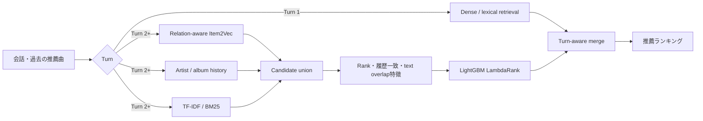

# RecSys Challenge 2026

[RecSys Challenge 2026: Music-CRS 公式サイト](http://www.recsyschallenge.com/2026/)

## コンペティション概要

RecSys Challenge 2026: Music-CRSは、対話を通じてユーザーの音楽嗜好を理解し、
楽曲を推薦する**会話型音楽推薦**のコンペティションです。システムには、過去の
会話とユーザープロファイルをもとにカタログから関連楽曲Top-20を順位付きで提示し、
その推薦理由を含む自然で一貫した応答を生成することが求められます。

1つの会話セッションは最大8ターン続きます。ここで1ターンとは、ユーザーの発話に
対してシステムが楽曲ランキングと応答を返す、1回のやり取りです。最初のTurn 1では
過去の推薦曲がまだありませんが、Turn 2以降（2〜8ターン目）では、それまでに
推薦した楽曲と会話の流れを次の推薦に利用できます。

評価は、推薦ランキングと生成応答の両面から行われます。公式の総合スコアは、
次の4指標の加重和です。

| 評価対象 | 指標 | 重み | 評価内容 |
|---|---|---:|---|
| 推薦ランキング | nDCG@20 | 0.50 | 正解楽曲を上位に推薦できているか |
| 推薦ランキング | Catalog Diversity | 0.10 | カタログ全体から幅広く推薦できているか |
| 生成応答 | Lexical Diversity | 0.10 | 推薦応答の表現に多様性があるか |
| 生成応答 | LLM-as-a-Judge | 0.30 | 応答のパーソナライズと推薦理由の品質 |

## 参加体制と私の担当

本コンペティションには、研究室メンバー計10名で構成するチーム
`uec_okmt_lab`として参加しました。
私は推薦ランキング側を担当し、特に過去の推薦履歴を利用できるTurn 2以降を
対象としたItem2Vec候補生成、複数検索手法の候補統合、特徴量設計、LightGBMによる
リランキング、turn別の評価・分析に取り組みました。

このリポジトリは、私の担当領域を技術ポートフォリオとして再構成したものです。
公開可能な合成データを用いて、会話初期と履歴が蓄積したターンを分けて扱う
候補検索＋Learning-to-Rankの二段階推薦システムを実行できます。

> このリポジトリは個人担当部分のポートフォリオ用再実装です。
> チーム全体の提出コード、Challengeデータ、Blind set、学習済みモデル、
> 外部APIで生成したembeddingは含みません。

## コンペティション結果

チーム`uec_okmt_lab`は、最終評価であるBlind Dataset Bにおいて、総合40チーム中
15位、Academic Trackでは17チーム中6位となりました。順位と評価値は
[公式最終結果](https://nlp4musa.github.io/music-crs-challenge/results.html)で公開されています。

| 区分 | 最終順位 |
|---|---:|
| 全参加チーム | **15位 / 40チーム** |
| Academic Track | **6位 / 17チーム** |

[English README](README_EN.md)

## 課題設定

最大8ターンの会話のうち、最初のTurn 1にはアイテム履歴がありません。一方、
Turn 2以降は「これまで推薦された曲」という強い逐次信号を利用できます。
全ターンに同じモデルを適用するのではなく、次の役割に分離しました。



## 私の担当範囲

- Item2VecによるTurn 2以降の候補生成
- アイテム系列とartist、album、tag、年代、会話テキストの関係学習
- TF-IDF、artist履歴検索、dense retrievalとの候補union設計
- source別の`present / inverse rank / log rank / score`特徴量
- artist・album履歴一致、query overlap、turn特徴量の設計
- KFold OOF候補を用いたreranker学習フロー
- LightGBM LambdaRankによる候補の再順位付け
- turn別Recall・Hit Rate・nDCG、候補重複、特徴量重要度の分析

## 実験で得られた知見

### 1. 複数のretrieval手法を比較する

最初に、会話や推薦履歴から正解楽曲の候補を見つけるretrieval手法を比較しました。
各手法の狙いは次のとおりです。

- **TF-IDF context**: ユーザーの発話に含まれるartist、曲名、album、tagなどの
  キーワードを重視し、文字として明示された要望に合う楽曲を検索します。
- **OpenAI embedding**: 累積した会話と楽曲情報をベクトルへ変換し、キーワードの
  完全一致だけでは捉えにくい雰囲気や嗜好の意味的な近さから楽曲を検索します。
- **BM25 dialogue**: listener goal、user profile、会話文をqueryとして、重要な
  キーワードが楽曲metadataへどの程度含まれるかを評価します。
- **BM25 item history**: それまでに推薦した楽曲のmetadataをqueryとして、過去の
  推薦履歴と関連する楽曲を検索します。このため、主にTurn 2以降で機能します。
- **Relation-aware Item2Vec**: 複数ユーザーのアイテム系列から楽曲同士の共起関係を
  学習し、さらにartist、album、tag、年代などのmetadata関係を同じ埋め込み空間へ
  統合します。推論時は、その時点までに推薦した楽曲embeddingを平均poolingして
  ユーザーの現在の嗜好を表し、そのベクトルに近い未推薦楽曲を上位候補とします。

Item2Vecは学習を伴うretrieverであるため、rerankerの学習候補を作る際にはKFoldの
out-of-fold（OOF）生成を行いました。各queryの候補は、そのqueryを学習に使用して
いないfoldのItem2Vecから生成し、rerankerへ過度に良いin-sampleの検索結果を渡す
データリークを防いでいます。

Dev 8,000 query・全8 Turnにおける、リランキング前の単体評価は次のとおりです。
Item2Vecのみ、履歴が存在するTurn 2〜8を対象とした参考値を併記しています。
各queryの正解は1曲のため、この設定ではItem2VecのRecall@KはHit@Kと一致します。

| Retriever | Hit@20 | Hit@100 | Hit@500 | nDCG@20 | nDCG@100 | nDCG@500 |
|---|---:|---:|---:|---:|---:|---:|
| TF-IDF context | **0.2968** | **0.4763** | 0.6143 | **0.1077** | **0.1409** | 0.1587 |
| OpenAI cumulative all roles | 0.2515 | 0.4614 | **0.6561** | 0.1014 | 0.1400 | **0.1650** |
| BM25 item history all | 0.2318 | 0.3910 | 0.5239 | 0.0793 | 0.1087 | 0.1259 |
| BM25 dialogue all | 0.1883 | 0.3166 | 0.4196 | 0.0754 | 0.0993 | 0.1125 |
| Relation-aware Item2Vec（Turn 2〜8） | 0.3054 | 0.5050 | 0.6977 | — | — | — |

Item2VecはUser発話を学習時の補助関係として加えた同一モデルの結果です。nDCGは
同じ評価条件の集計値が残っていないため記載していません。また、他の4手法は全8 Turn、
Item2VecはTurn 2〜8の評価であり、太字による単純な優劣比較の対象外としています。

TF-IDFは上位20〜100件の精度、OpenAI embeddingは上位500件までの広い候補回収で
最良でした。また、BM25では会話文だけを使うより、過去の推薦履歴を使う方が
高い精度となりました。このように、retrieverごとに捉えられる情報と得意な候補幅が
異なるため、1つの手法だけに絞らず、それぞれの候補を統合する方針を採用しました。

### 2. 検索結果を統合してリランキングする

複数sourceの候補をunionし、各候補について「どの検索手法で見つかったか」
「その検索結果で何位・何点だったか」を保持しました。さらに、履歴との
artist・album一致や会話文との一致度を加え、LightGBM LambdaRankで最終順位を
学習しました。

全8 Turn評価の各指標で最良だった単体retrieverと、候補統合＋リランキング後の
結果を比較すると、すべての指標で改善しました。

| 段階 | Hit@20 | Hit@100 | Hit@500 | nDCG@20 | nDCG@100 | nDCG@500 |
|---|---:|---:|---:|---:|---:|---:|
| リランキング前の最良単体retriever（全8 Turn） | 0.2968 | 0.4763 | 0.6561 | 0.1077 | 0.1409 | 0.1650 |
| 候補統合＋LightGBMリランキング | **0.3779** | **0.5711** | **0.7229** | **0.1880** | **0.2237** | **0.2434** |
| 絶対改善幅 | **+0.0811** | **+0.0948** | **+0.0668** | **+0.0803** | **+0.0828** | **+0.0784** |

特にnDCG@20は`0.1077`から`0.1880`へ向上し、相対改善率は約74.6%でした。
これは、検索手法ごとの異なる強みを候補unionと学習型リランキングで組み合わせる
二段階構成の有効性を示しています。なお、この比較は候補union・特徴量設計・
LightGBMを含むパイプライン全体の効果であり、rankerだけを差し替えたablationでは
ありません。

### 3. 候補数とRecallのトレードオフ

Turn 2以降では、上記のretrieverにItem2Vecとartist履歴検索も加えて候補プールを
構築しました。候補数を増やすと正解楽曲を拾いやすくなる一方、後段rankerの計算量と
並べ替えの難易度も上がります。

| Item2Vec Top-N | Artist Top-N | TF-IDF Top-N | 平均候補数 | Recall |
|---:|---:|---:|---:|---:|
| 150 | 75 | 50 | 199.8 | 0.6533 |
| 200 | 75 | 150 | 324.5 | 0.7021 |
| **300** | **100** | **200** | **460.6** | **0.7407** |
| 500 | 150 | 500 | 901.9 | 0.8003 |

約461件でRecall 0.7407の構成を、精度と効率の開始点としました。

これはチーム環境で得た開発セット上の値です。公開デモは合成データを使うため、
この数値を再現するものではありません。

単体retrieverのTurn別結果は
[Pre-Rerank Retriever Results](pre_rerank_retriever_results.md)、設計上の考察は
[実験レポート](reports/experiment_summary.md)にまとめています。

## 実装

```text
src/turnaware_recsys/
├── item2vec.py        # metadata relationを加えたItem2Vec
├── lexical.py         # 再現用TF-IDF retriever
├── candidate_pool.py  # source別順位を保持する候補union
├── features.py        # 順位・履歴・query特徴量
├── reranker.py        # Turn 2+のLambdaRank / sklearn fallback
├── evaluation.py      # hit rate・nDCGのturn別評価
└── demo.py            # 合成データのend-to-end実行
```

## クイックスタート

Python 3.10以降を使用します。

```bash
python -m venv .venv
source .venv/bin/activate
pip install -e ".[all]"
python -m turnaware_recsys.demo
```

LightGBMを入れない場合も、scikit-learnのfallbackでrerankerを実行できます。

```bash
pip install -e ".[item2vec]"
python -m turnaware_recsys.demo
```

テスト：

```bash
pip install -e ".[dev]"
pytest -q
```

## 再現性とリーク対策

本番相当の学習では、train queryに対してKFold OOFで候補を生成し、同じqueryを
学習したretrieverの過学習スコアをrerankerへ渡さない設計を採用しました。
また、Turn 1を系列モデルの教師から除外し、`turn_number >= 2`だけでrankerを
学習します。この公開デモは処理の理解を目的とした小規模版です。

## データについて

`examples/synthetic_data.json`は、このリポジトリ専用に作成した架空の曲・会話です。
実際のChallengeデータやSpotify由来データは再配布していません。

## Acknowledgements

This work was developed from my contribution to a team entry for the ACM RecSys
Challenge 2026 Music Conversational Recommendation task. The challenge organizers,
dataset authors, official baselines, and my teammates are acknowledged for the shared
task and collaborative environment. This repository contains only my portfolio-oriented
reimplementation and aggregate experimental observations.
